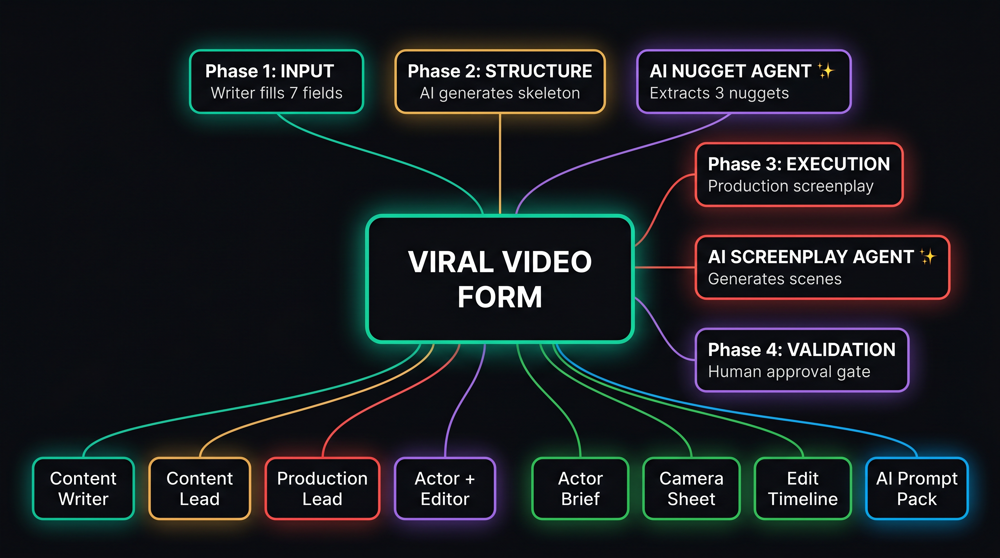
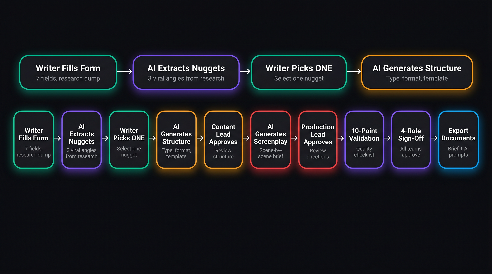

# Viral Video Production Form — Complete Guide
## For AI Agent and Sub-Agent Creation

---

## 1. PROJECT OVERVIEW

### What This Is
A 5-phase web-based production form that takes a content writer's research (up to 40 pages) and converts it into a production-ready screenplay for short-form viral videos (30-60 seconds) for Instagram Reels, TikTok, and YouTube Shorts.

### The Problem It Solves
- Content writers copy-paste AI-generated garbage into scripts
- 40 pages of research cannot be compressed into a 30-second video
- Editors don't know camera angles, cuts, or transitions
- Actors don't know expressions, tone, or body language
- Dialogue sounds robotic because it's spoken, not demonstrated

### The Solution
**Structured constraints + AI assistance + Human validation**

The form forces writers into 7 structured fields (no open-ended text). AI extracts viral nuggets from research. AI generates the production screenplay. Humans validate before filming.

### Live Form URL
https://rbcm2h5ijpzgq.kimi.page

---

## 2. SYSTEM ARCHITECTURE

**Central Hub:** Viral Video Form

**5 Phases:**
- Phase 1: INPUT (teal) — Writer fills 7 fields
- Phase 2: STRUCTURE (amber) — AI generates skeleton
- Phase 3: EXECUTION (red) — Production screenplay
- Phase 4: VALIDATION (violet) — Human approval gate
- Phase 5: OUTPUT (sky) — Export documents

**2 AI Agents:**
- AI Nugget Agent (violet) — Extracts 3 nuggets from 40 pages of research
- AI Screenplay Agent (red) — Generates scene-by-scene production brief

**4 Team Roles:**
- Content Writer (teal) — Fills Phase 1
- Content Lead (amber) — Approves Phase 2
- Production Lead (red) — Approves Phase 3
- Actor + Editor (violet) — Validates Phase 4

**4 Output Documents:**
- Actor Brief (green) — Dialogue + direction per scene
- Camera Sheet (green) — Shot list + settings per scene
- Edit Timeline (green) — Cut points + transitions + captions
- AI Agent Prompt Pack (sky) — JSON data + 5 prompt templates

---

## 3. LINEAR WORKFLOW (Step-by-Step)

**The 10-Step Execution Flow:**

| Step | Action | Who | Color |
|------|--------|-----|-------|
| 1 | Writer Fills Form | Content Writer | Teal |
| 2 | AI Extracts Nuggets | AI Nugget Agent | Violet |
| 3 | Writer Picks ONE | Content Writer | Teal |
| 4 | AI Generates Structure | AI System | Amber |
| 5 | Content Lead Approves | Content Lead | Amber |
| 6 | AI Generates Screenplay | AI Screenplay Agent | Red |
| 7 | Production Lead Approves | Production Lead | Red |
| 8 | 10-Point Validation | Actor + Editor | Violet |
| 9 | 4-Role Sign-Off | All Roles | Violet |
| 10 | Export Documents | Auto-Generated | Sky |

---

## 4. PHASE 1: INPUT — THE 7 FIELDS

### 4.1 Field 1: Video Identity
| Field | Type | Example |
|-------|------|---------|
| Production Date | Date picker | 05/29/2026 |
| Content Creator | Text | Sarah K. |
| On-Camera Actor | Dropdown | Sarah Chen, Marcus Johnson, Ava Kim, David Park |
| Brand / Company | Dropdown | GlowUp Beauty, FitLife Co, TechSimplify, Backero |
| Platform | Dropdown | Instagram, TikTok, YouTube Shorts, Facebook Reels |
| Estimated Length | Dropdown | 15-30s, 30-60s, 60-90s, 90-120s |

### 4.2 Field 2: Raw Research Dump
Large textarea. Paste all research — articles, stats, notes, links, thoughts. Min 100 characters.

**Example input:**
- Article: "73% of SaaS companies fail because of poor onboarding"
- My experience: We reduced churn by 40% with one email change
- Stat: Average user attention span on Reels is 1.7 seconds
- Competitor video got 2M views with similar hook

### 4.3 Field 3: AI Nugget Extraction (AI-Generated)
After clicking "Extract Nuggets," AI produces 3 selectable cards:

| Nugget Type | Example |
|-------------|---------|
| **Shocking Fact** | "70% of vitamin C serums oxidize before you finish the bottle" |
| **Practical Hack** | "Store serum in the fridge — doubles effectiveness" |
| **Story Hook** | "I spent $2,000 on serums before learning this one trick" |

### 4.4 Field 4: One Point Selector
Radio cards to pick ONE nugget. Others saved as future topics.

**Why This Nugget?** (max 40 words, forced format):
"A [target viewer] scrolling [platform] will stop because..."

### 4.5 Field 5: Topic — Forced Format

**Niche:** Free text (e.g., "Skincare")
**Sub-Niche:** Free text (e.g., "Anti-aging")

Three forced-format sentences:

| Sentence | Prefix | Max Words | Example |
|----------|--------|-----------|---------|
| The Point | "This video teaches..." | 20 | "...how to keep your vitamin C serum from oxidizing" |
| Why They Care | "They care because..." | 20 | "...nobody wants to waste money on serums that stop working" |
| The Proof | "Trust me because..." | 20 | "...I've tested 20+ serums and the fridge trick always works" |

**Topic Validation Checkboxes (ALL must be checked):**
1. Demand — People search for this
2. Relevance — Fits our niche
3. Interest — Trending or evergreen
4. Knowledge — We have credibility

### 4.6 Field 6: Value Delivery

| Field | Type | Example |
|-------|------|---------|
| Actionable Takeaway | Text (25 words) | "After watching, the viewer will be able to store their vitamin C serum correctly" |
| Content Style | Dropdown | Demonstration, Reaction, Story, Comparison, Reveal, Challenge |
| Time to Value | Dropdown | 0-3s, 3-5s, 5-10s, 10s+ |

**Fluff vs. Specific — Live Reference (3 Examples):**

| FLUFF (Bad) | SPECIFIC (Good) |
|-------------|-----------------|
| "This serum is amazing" | "This serum reduced my dark spots in 14 days" |
| "Everyone is talking about this" | "This went viral on TikTok with 2.4M views" |
| "You need to follow these tips" | "Step 1: Put it in the fridge. That's it." |

**Self-Check Questions:**
1. Does every word earn its place? (Yes/No)
2. Would a viewer save or share this? (Yes/No)
3. Is the takeaway actionable within 24 hours? (Yes/No)

### 4.7 Field 7: Reference Video

| Field | Type | Example |
|-------|------|---------|
| Video URL | URL | https://www.tiktok.com/@creator/video/1234567890 |
| What are we copying? | Dropdown | Full Structure, Hook Only, Visual Style, Energy, Tone, Format |
| Describe what we're taking | Text | "The rapid-fire cut sequence from 0:08 to 0:15" |

**Viral Threshold Rule:** Video views >= 5x creator's subscriber count (3x for 1M+ subs)

---

## 5. PHASE 2: STRUCTURE

### 5.1 Content Type (5 Types)

| Type | Frequency | CTA Match | When to Use |
|------|-----------|-----------|-------------|
| Educational | 3-5x/week | Follow/Save | Teaching a skill |
| Storytelling | 1-2x/week | Follow | Sharing experience |
| Authority/Trust | 1x/week | Comment then DM | Proving credibility |
| Personal/Relatable | 1-2x/week | Follow | Behind-the-scenes |
| Trending/Entertainment | As needed | Share/Comment | Riding trends |

### 5.2 Format Selection (S/A/B/F Tiers)

| Tier | Formats |
|------|---------|
| S-Tier | Clone, Talking Back & Forth, Visual Prop Explainer, Carousel/Slide Deck |
| A-Tier | Voiceover + Visuals, Whiteboard |
| B-Tier | Trending Audio + B-roll |
| F-Tier | B-roll Only |

### 5.3 Script Structure Templates (6 Templates)

| Template | Type | Timing Flow |
|----------|------|-------------|
| A | Step-by-Step | Hook -> Authority -> Framework -> Steps -> CTA |
| B | Comparison | Hook -> A -> B -> Test -> Results -> CTA |
| C | Storytelling | Context -> Pain -> Turning Point -> Lesson -> CTA |
| D | Shocking Fact | Hook -> Reaction -> Proof -> Implication -> Solution -> CTA |
| E | Practical Hack | Hook -> Problem -> Setup -> Steps -> Result -> CTA |
| F | Story Hook | Hook -> Story -> Low Point -> Discovery -> Lesson -> CTA |

### 5.4 3-Hook Rule

| Hook Layer | What | Max |
|------------|------|-----|
| Visual Hook | First 0.5 seconds seen | 1 sentence |
| Written Hook | On-screen text | 8 words |
| Audio Hook | First 1 second | 3-5 words |

### 5.5 Visual Hook Quality Rating (GAP 7)

| Rating | Criteria | Action |
|--------|----------|--------|
| GREAT | Action happening, high contrast, result shown | Proceed |
| GOOD | Face visible, some action, predictable | Proceed with note |
| BAD | Static frame, talking head, no action | REJECT — rewrite |

### 5.6 CTA Type Matching (GAP 3)

| Content Type | CTA Type | Example |
|-------------|----------|---------|
| Educational | Follow/Save | "Save this for later" |
| Storytelling | Follow | "Follow if you relate" |
| Authority | Comment then DM | "Comment 'GUIDE' for my free checklist" |

**Rules:** ONE CTA only. Max 5 words. Must match content type.

---

## 6. PHASE 3: EXECUTION — PRODUCTION SCREENPLAY

### 6.1 Golden Rules

1. **Show Don't Tell** — Every fact must be SHOWN (hold up the bottle, show the receipt), not just spoken
2. **No Talking Head >2s** — After 2 seconds of talking, something must change
3. **Silent Moments** — Reaction shots, product reveals, before/after cuts need no dialogue

### 6.2 Scene Card Format

Each scene contains:
- **Timing:** Start-end seconds
- **Dialogue:** With action parentheticals (Actor: does X while saying Y)
- **Camera Direction:** Shot type, angle, movement, lens, framing
- **Actor Direction:** Expression, eye contact, body language, energy 1-10, pace, tone
- **Visual Elements:** On-screen text, props, background, graphic overlays
- **Audio Direction:** Voice/music/SFX/transitions
- **Editing Markers:** Cut point, transition type, caption style, speed ramp

### 6.3 Dialogue Engineering Rules

| Rule | Spec |
|------|------|
| Max words per line | 15 |
| Emphasis | 1-2 words marked for vocal stress |
| Pauses | Breathing points indicated |
| Forbidden words | "revolutionary", "unlock", "discover" |
| Contraction rule | Use contractions (conversational) |
| Bridge words | Every sentence must bridge to the next |

### 6.4 Caption Specifications

| Property | Spec |
|----------|------|
| Max words per line | 5-7 |
| Max lines on screen | 2 |
| Font | Bold sans-serif, white with black outline |
| Animation | Pop-in per word or line |
| Position | Bottom third, centered |

---

## 7. PHASE 4: VALIDATION

### 7.1 10-Point Checklist

| # | Check | Pass Criteria |
|---|-------|---------------|
| 1 | Hook stops scroll | Stranger stops in 0.5s |
| 2 | Value arrives fast | Within first 3-5 seconds |
| 3 | Dialogue sounds human | Read aloud — sounds natural |
| 4 | 10-year-old test | A child could understand |
| 5 | Camera directions clear | Cameraman knows what to do |
| 6 | Actor directions specific | Actor knows expression/pace/energy |
| 7 | Cut points marked | Editor knows where every cut is |
| 8 | ONE clear CTA | Exactly one, max 5 words, at end |
| 9 | Captions for mute | Muted viewer understands everything |
| 10 | Visual changes every 1-2s | Cut/text/graphic/movement every 2s |

**ALL 10 must pass before filming.**

### 7.2 4-Role Approval

| Role | Reviews | Sign-off |
|------|---------|----------|
| Content Lead | Phase 1 + 2 | Content on-brand |
| Production Lead | Phase 3 | Production executable |
| Actor | Their scenes | Acknowledges they can perform |
| Editor | Full Edit Timeline | Editing plan is clear |

---

## 8. PHASE 5: OUTPUT

### 8.1 Simple Brief (Human-Readable)

| Document | For Who | Contains |
|----------|---------|----------|
| Actor Brief | Actor | Scenes + dialogue + direction |
| Camera Sheet | Cameraman | Shot list + settings |
| Edit Timeline | Editor | Cut points + transitions + captions |
| Clean Script | Everyone | Dialogue only, numbered lines |

### 8.2 AI Agent Prompt Pack (For Future Automation)

Structured JSON + 5 prompt templates:

| # | Agent | Purpose |
|---|-------|---------|
| 1 | Script Writer Agent | Write viral scripts using the structure |
| 2 | Scene Breakdown Agent | Convert script into shot-by-shot breakdown |
| 3 | Actor Direction Agent | Generate actor direction for each scene |
| 4 | Camera Direction Agent | Generate camera settings for each shot |
| 5 | Edit Timeline Agent | Generate editing timeline with cut points |

---

## 9. AI AGENT CREATION GUIDE

### Agent 1: AI Nugget Agent

**Input:** Raw research text (up to 40 pages)
**Output:** 3 nuggets (Shocking Fact, Practical Hack, Story Hook)
**Rules:**
- Each nugget max 25 words
- Must contain a number, percentage, or specific claim
- Must not contain generic phrases

### Agent 2: AI Screenplay Agent

**Input:** Selected nugget + topic sentences + value + content style
**Output:** Full scene-by-scene production brief (5-6 scenes, 30-60 seconds)
**Rules:**
- Follow the selected script template timing
- Every dialogue line must have action parentheticals
- Camera + Actor + Visual + Audio direction per scene
- Show Don't Tell — every fact demonstrated
- No Talking Head >2 seconds
- Bridge words between sentences
- CTA max 5 words, one only

---

## 10. COMPLETE REQUIREMENTS CHECKLIST

| # | Requirement | Status |
|---|-------------|--------|
| 1 | 10-year-old can write content | YES — forced formats, dropdowns |
| 2 | 40-page research compression | YES — Raw Research -> 3 nuggets -> pick 1 |
| 3 | Editors know camera/cuts | YES — Phase 3 camera direction + edit markers |
| 4 | Actors know expressions | YES — Phase 3 actor direction per scene |
| 5 | Dialogue demonstrated, not spoken | YES — Action-integrated screenplay |
| 6 | ChatGPT constraints | YES — 5 anti-AI guardrails |
| 7 | Show Don't Tell | YES — Global rule in Phase 3 |
| 8 | No Talking Head >2s | YES — Global rule in Phase 3 |
| 9 | Silent Moments | YES — Global rule in Phase 3 |
| 10 | One video = one point | YES — One Point Selector enforces |
| 11 | 5x viral threshold rule | YES — Reference Video field |
| 12 | Reference video multi-purpose | YES — 6-option dropdown |
| 13 | Sentence flow (Chain Rule) | YES — Bridge words between lines |
| 14 | Fluff check with 3 examples | YES — Live Reference table |
| 15 | Simple form (7 fields) | YES — 7 cards, minimal free text |
| 16 | Dual export (human + AI) | YES — Simple Brief + AI Agent Pack |
| 17 | 10-point validation | YES — Phase 4 checklist |
| 18 | 4-role approval | YES — Phase 4 sign-off workflow |
| 19 | 5 AI agent prompt templates | YES — Phase 5 output |
| 20 | Workflow mind map page | YES — /workflow route |
| 21 | GAP 3: CTA Type Matching | YES — Phase 2 CTA card |
| 22 | GAP 7: Visual Hook Quality | YES — Phase 2 Hook Framework |
| 23 | GAP 16: Viral Structure Copy | YES — Phase 1 Reference Video |
| 24 | Niche/Sub-niche free text | YES — Manual entry by creator |
| 25 | Fluff table 3 examples only | YES — Exactly 3 rows |
